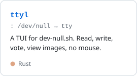
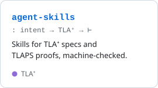
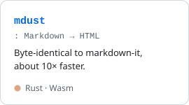
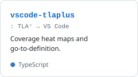
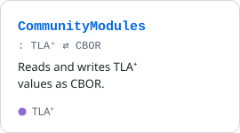
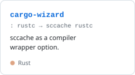

<picture><source media="(prefers-color-scheme: dark)" srcset="cards/header-dark.svg"></picture>

#### `~/src`

<a href="https://github.com/younes-io/ttyl"><picture><source media="(prefers-color-scheme: dark)" srcset="cards/ttyl-dark.svg"></picture></a>
<a href="https://github.com/younes-io/agent-skills"><picture><source media="(prefers-color-scheme: dark)" srcset="cards/agent-skills-dark.svg"></picture></a>
<a href="https://github.com/younes-io/mdust"><picture><source media="(prefers-color-scheme: dark)" srcset="cards/mdust-dark.svg"></picture></a>

#### `~/upstream`

<a href="https://github.com/tlaplus/vscode-tlaplus/pulls?q=is%3Apr+author%3Ayounes-io+is%3Amerged"><picture><source media="(prefers-color-scheme: dark)" srcset="cards/vscode-tlaplus-dark.svg"></picture></a>
<a href="https://github.com/tlaplus/CommunityModules/pulls?q=is%3Apr+author%3Ayounes-io+is%3Amerged"><picture><source media="(prefers-color-scheme: dark)" srcset="cards/CommunityModules-dark.svg"></picture></a>
<a href="https://github.com/Kobzol/cargo-wizard/pulls?q=is%3Apr+author%3Ayounes-io+is%3Amerged"><picture><source media="(prefers-color-scheme: dark)" srcset="cards/cargo-wizard-dark.svg"></picture></a>

<a href="https://younes.io">younes.io</a>

